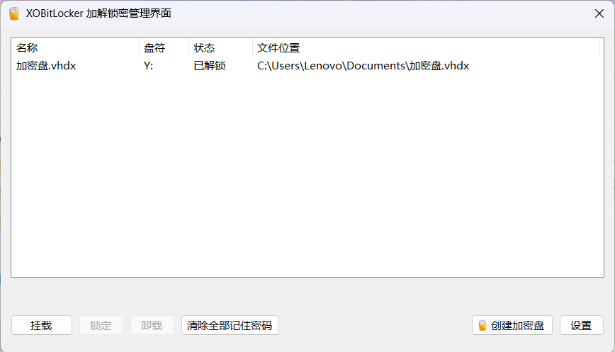
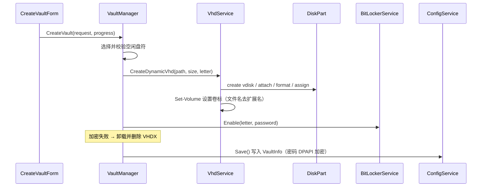
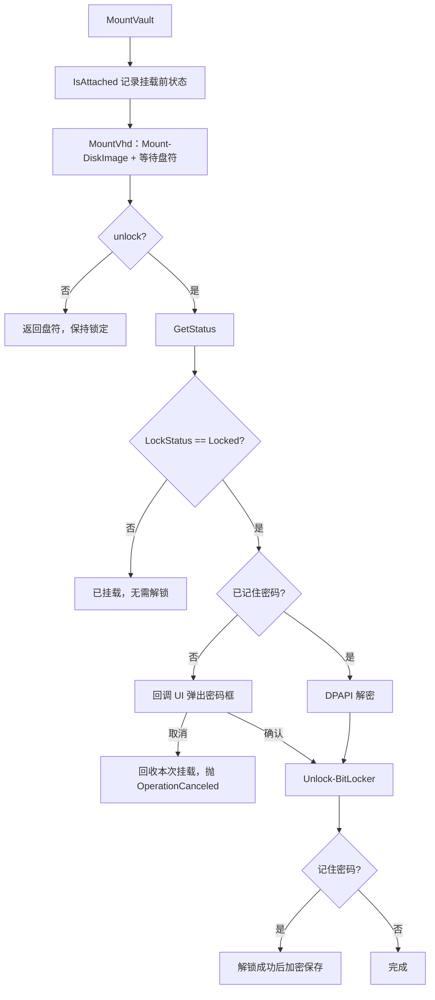
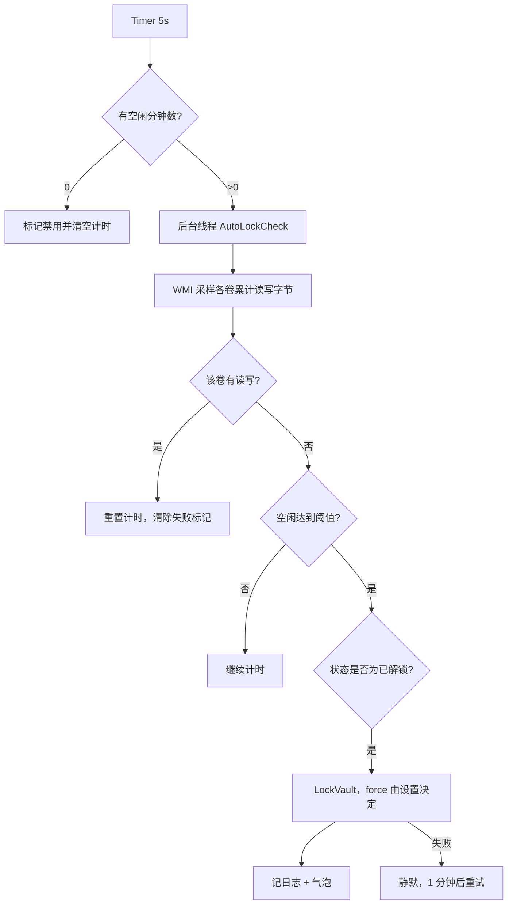
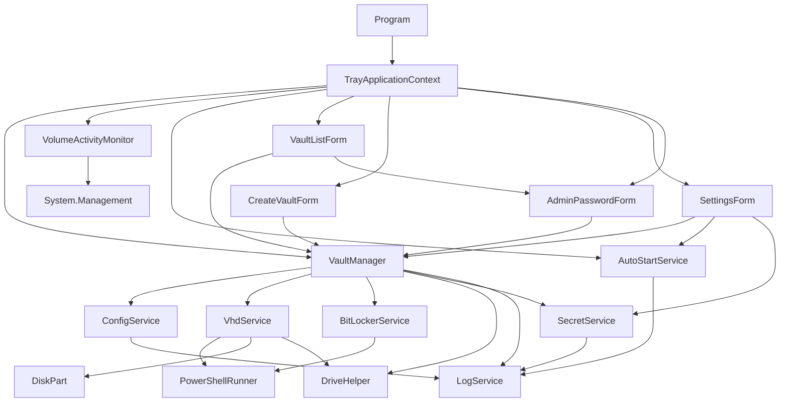

# XOBitLocker加解锁密盘



> 基于 BitLocker 的 Windows 托盘加密盘管理工具：一键创建 VHDX 加密盘、挂载/解锁、锁定/卸载，并支持空闲自动锁定与登录自动挂载。

**技术栈**：C# 7.3 · .NET Framework 4.8 · WinForms  
**产物**：单文件 `dist\XOBitLocker.exe`（约 160–165 KB，无第三方依赖）  
**适用系统**：Windows 10 / 11 专业版或企业版（需支持 BitLocker）家庭版不支持。

---

## 目录

- [1. 项目简介](#1-项目简介)
- [2. 功能特性](#2-功能特性)
- [3. 技术栈与运行环境](#3-技术栈与运行环境)
- [4. 目录结构](#4-目录结构)
- [5. 系统架构](#5-系统架构)
- [6. 核心类与函数说明](#6-核心类与函数说明)
- [7. 数据模型与配置](#7-数据模型与配置)
- [8. 依赖关系](#8-依赖关系)
- [9. 编译与运行](#9-编译与运行)
- [10. 使用说明](#10-使用说明)
- [11. 安全设计](#11-安全设计)
- [12. 日志与故障排查](#12-日志与故障排查)
- [13. 已知限制](#13-已知限制)

---

## 1. 项目简介

XOBitLocker 是一个常驻系统托盘的 Windows 小工具，把「虚拟硬盘（VHDX） + BitLocker 加密」这套命令行操作封装成了图形界面：

- 在任意目录创建一个**动态扩展的 VHDX 文件**，自动分区、格式化并启用 BitLocker；
- 以「加密盘」为单位管理：挂载、解锁、锁定、卸载、修改盘符、修改/清空密码、移除或删除；
- 记住密码后，双击列表即可免密解锁；
- 按**该盘自身的磁盘读写活动**判断空闲，超时自动锁定；
- 通过**登录触发的高权限计划任务**实现静默开机自启与自动挂载。

项目不依赖任何第三方库，也不依赖 .NET SDK：构建脚本直接调用 VS Build Tools 自带的 Roslyn 编译器，把全部源码编译成单个 WinForms 可执行文件。

---

## 2. 功能特性

| 功能 | 说明 |
|---|---|
| 托盘常驻 | 图标取自 exe 内嵌的 `lock.ico`，右键菜单 + 双击打开管理界面 |
| 创建加密盘 | 选择保存位置、大小（MB/GB/TB，最小 100 MB）、固定 VHDX 动态扩展、密码（≥8 位） |
| 挂载 / 解锁 | 支持列表内加密盘与列表外的 `.vhd` / `.vhdx` 文件；可勾选「记住密码」 |
| 锁定 / 全部锁定 | 手动锁定始终强制卸载；自动锁定是否强制由设置项决定 |
| 卸载 | 先尝试锁定，再 `Dismount-DiskImage` |
| 修改盘符 | 仅列出真正空闲的盘符（含已映射的网络盘） |
| 修改 / 清空密码 | 空密码表示删除密码保护器；「未加密」状态可重新设置密码恢复保护 |
| 删除 / 移除列表 | 「删除」可选择是否连同 VHDX 文件一起删除 |
| 自动锁定 | 每个盘独立计时，默认判据为该盘的磁盘读写活动 |
| 开机自启 | 计划任务 `XOBitLocker`（`ONLOGON` + `Highest`），避免每次登录弹 UAC |
| 自动挂载 | 可多选加密盘；可选「自动解密」，否则只挂载并保持锁定 |
| 管理密码 | 启用后，进入管理界面与设置前需验证；DPAPI 加密存储 |
| 单实例 | 命名互斥量 `Global\BitLockerVault.SingleInstance` |
| 日志 | `%AppData%\XOBitLocker\logs\app-yyyyMMdd.log` |

---

## 3. 技术栈与运行环境

| 项目 | 选型 |
|---|---|
| 语言 / 版本 | C# 7.3 |
| 运行时 | .NET Framework 4.8（Windows 10 1903+ / Windows 11 内置） |
| UI | WinForms（`ApplicationContext` + `NotifyIcon` + `ContextMenuStrip`） |
| 权限 | `App.manifest` → `requireAdministrator` |
| 平台 | `AnyCPU`（实际调用 64 位系统命令） |
| DPI | `PerMonitorV2` + `longPathAware` |
| 序列化 | `System.Web.Extensions` 的 `JavaScriptSerializer` |
| 密码保护 | Windows DPAPI（`DataProtectionScope.CurrentUser`） |
| 构建 | Roslyn `csc.exe`（VS Build Tools），无 `.csproj` |

**运行前提**

1. Windows 10/11 **专业版 / 企业版**（家庭版无 BitLocker）；
2. 以管理员身份运行（manifest 已强制，启动时会弹 UAC）；
3. PowerShell、`diskpart`、`manage-bde`、`schtasks` 可用（系统自带）；
4. 需要 WMI 服务（`Win32_PerfRawData_PerfDisk_LogicalDisk`）用于空闲检测，不可用时自动降级。

---

## 4. 目录结构

```
XOBitLocker/
├─ build.ps1                          # 构建脚本（直接调用 Roslyn csc.exe）
├─ lock.ico                           # 程序图标 / 托盘图标
├─ README.md
├─ BitLocker加解锁密盘软件开发.md      # 需求与迭代记录
├─ dist/
│  └─ XOBitLocker.exe                 # 构建产物
└─ src/
   ├─ Program.cs                      # 入口：单实例 + 启动托盘上下文
   ├─ TrayApplicationContext.cs       # 托盘、菜单、自动锁定、开机自动挂载
   ├─ AssemblyInfo.cs                 # exe 属性（文件说明/产品名/版权/版本）
   ├─ App.manifest                    # 管理员权限、DPI、系统兼容性
   ├─ Models/
   │  ├─ AppConfig.cs                 # 全局配置
   │  ├─ VaultInfo.cs                 # 单个加密盘
   │  ├─ BitLockerStatus.cs           # VaultState 枚举 + VolumeStatus 快照
   │  └─ CreateVaultRequest.cs        # 创建请求参数
   ├─ Services/
   │  ├─ ConfigService.cs             # config.json 读写
   │  ├─ LogService.cs                # 按天滚动的简易日志
   │  ├─ SecretService.cs             # DPAPI 加解密
   │  ├─ PowerShellRunner.cs          # PowerShell 执行器 + 输出清洗
   │  ├─ DriveHelper.cs               # 盘符占用/空闲/候选
   │  ├─ VhdService.cs                # VHDX 创建/挂载/卸载/改盘符（含 DiskPart）
   │  ├─ BitLockerService.cs          # 加密/解锁/锁定/状态/改密/清密
   │  ├─ AutoStartService.cs          # 计划任务开机自启
   │  ├─ VolumeActivityMonitor.cs     # 按卷磁盘读写活动采样
   │  └─ VaultManager.cs              # 业务编排层
   └─ Forms/
      ├─ VaultListForm.cs             # 管理界面（列表 + 右键菜单）
      ├─ CreateVaultForm.cs           # 创建加密盘
      ├─ SettingsForm.cs              # 设置
      └─ AdminPasswordForm.cs         # 管理密码校验 / 设置
```

---

## 5. 系统架构

### 5.1 分层架构

```
┌─────────────────────────────────────────────────────┐
│  表现层  Program / TrayApplicationContext / Forms    │
│  托盘菜单、管理界面、创建、设置、管理密码对话框        │
└──────────────────────────┬──────────────────────────┘
                           │ 调用
┌──────────────────────────▼──────────────────────────┐
│  业务编排层  VaultManager                            │
│  配置 + VHD + BitLocker 的组合事务、状态推导          │
└──────────────────────────┬──────────────────────────┘
                           │ 调用
┌──────────────────────────▼──────────────────────────┐
│  服务层  VhdService / BitLockerService /              │
│          AutoStartService / VolumeActivityMonitor /   │
│          ConfigService / SecretService / LogService   │
└──────────────────────────┬──────────────────────────┘
                           │ 进程调用 / API
┌──────────────────────────▼──────────────────────────┐
│  系统能力  PowerShell · diskpart · manage-bde ·       │
│            schtasks · WMI · DPAPI · NotifyIcon        │
└─────────────────────────────────────────────────────┘
```

### 5.2 各层职责

| 层 | 组成 | 职责 |
|---|---|---|
| 表现层 | `Program`、`TrayApplicationContext`、`Forms/*` | 进程生命周期、托盘交互、对话框、后台任务与 UI 线程切换 |
| 业务编排层 | `VaultManager` | 唯一持有 `AppConfig` 的业务入口；把「配置文件 + VHD + BitLocker」组合成事务性操作 |
| 系统服务层 | `VhdService`、`BitLockerService`、`AutoStartService`、`VolumeActivityMonitor`、`PowerShellRunner`、`DiskPart` | 封装单个系统能力，所有命令都通过脚本执行并解析输出 |
| 基础设施层 | `ConfigService`、`SecretService`、`LogService`、`DriveHelper` | 配置持久化、密码保护、日志、盘符计算 |

### 5.3 关键流程

**创建加密盘**



**挂载并解锁**



**自动锁定（每 5 秒轮询，每盘独立计时）**



---

## 6. 核心类与函数说明

### 6.1 入口与托盘

#### `Program`（`src/Program.cs`）

| 成员 | 说明 |
|---|---|
| `MutexName` | `Global\BitLockerVault.SingleInstance`，跨会话单实例 |
| `Main()` | 创建互斥量；已存在则提示并退出；否则 `Application.Run(new TrayApplicationContext())`；异常写入日志并弹窗 |

#### `TrayApplicationContext`（`src/TrayApplicationContext.cs`）

托盘应用的核心控制器，继承 `ApplicationContext`。

| 成员 | 说明 |
|---|---|
| `_manager` | 全局唯一的 `VaultManager` 实例 |
| `_menu` / `_tray` | 托盘右键菜单与图标；图标通过 `Icon.ExtractAssociatedIcon` 从自身 exe 提取 |
| `_lockTimer` | 5 秒间隔的自动锁定轮询定时器 |
| `_activity` | `VolumeActivityMonitor`，WMI 读写采样 |
| `_idleSince` | `Vault.Id → 最后一次有读写的时间`，实现每盘独立计时 |
| `_uiContext` | UI 线程 `SynchronizationContext`，后台线程弹气泡时封送 |
| `OnMenuOpening()` | 动态构建菜单：自启勾选状态、自动挂载多选子菜单、已挂载盘的锁定额 |
| `OnToggleAutoStart()` | 调用 `AutoStartService.SetEnabled` 并同步 `AppConfig.AutoStart` |
| `LockOne()` / `LockAll()` | 单个 / 全部锁定（手动操作固定 `forceDismount = true`） |
| `OnLockTimerTick()` | `Interlocked` 防重入，把检查投递到后台线程 |
| `AutoLockCheck(minutes)` | 核心自动锁定算法：按盘判定 I/O → 计时 → 锁定；失败静默重试 |
| `AutoMountAtStartup()` | 启动 1.5 秒后挂载所有 `AutoMount` 盘；`AutoUnlockOnAutoMount` 决定是否解密；不弹气泡 |
| `EnsureAutoStartTask()` | 配置为开启但计划任务缺失时补建 |
| `GetIdleTime()` | Win32 `GetLastInputInfo`，WMI 不可用时的降级判据 |

### 6.2 业务编排

#### `VaultManager`（`src/Services/VaultManager.cs`）

应用唯一的业务门面，所有界面都只与它交互。

| 方法 | 说明 |
|---|---|
| `Config` / `Vaults` / `Reload()` / `Save()` | 配置访问与持久化（`lock` 保护） |
| `CreateVault(request, progress)` | 校验盘符 → 创建 VHDX → 启用 BitLocker → 写配置；加密失败自动清理文件 |
| `MountVault(vault, progress, unlock, askPassword)` | 挂载（可选解锁）；未记住密码时通过回调向 UI 索要；取消会回滚本次挂载 |
| `AttachVhdFile(path, pwd, remember, progress)` | 挂载列表外的 vhdx/vhd，成功后加入配置列表 |
| `LockVault(vault, force)` | 锁定单个盘（不卸载） |
| `LockAll(force)` | 锁定所有处于 `Unlocked` 的盘，返回成功数量 |
| `UnmountVault(vault, force)` | 先尽力锁定，再卸载 VHDX |
| `GetVaultState(vault)` / `StateText(state)` | 查询并转换为中文状态文本 |
| `ChangeDriveLetter(vault, newLetter)` | 校验空闲后调用 `Set-Partition -NewDriveLetter` |
| `ChangePassword(vault, newPassword)` | 空串 → 清空密码；否则调用 BitLocker 改密流程 |
| `ForgetPassword` / `ForgetAllPasswords` | 清除已记住的密码（仅清配置，不影响 BitLocker 保护器） |
| `IsAdminPasswordEnabled` / `VerifyAdminPassword` / `SetAdminPassword` | 管理密码的读写与校验 |
| `RemoveVault(vault, deleteFile)` | 卸载 → 移除配置 → 可选删除 VHDX |
| `GetAutoMountVaults()` | 过滤 `AutoMount && VhdPath` 非空 |

配套类型：

- `PasswordInput { Password, Remember }`：密码回调结果；
- `PasswordPrompt`：`delegate PasswordInput PasswordPrompt(VaultInfo vault)`，返回 `null` 表示用户取消。

### 6.3 系统服务

#### `VhdService` + `DiskPart`

| 方法 | 实现要点 |
|---|---|
| `CreateDynamicVhd(path, sizeBytes, letter)` | 生成 diskpart 脚本：`create vdisk ... type=expandable` → `attach` → `create partition primary` → `format fs=ntfs quick` → `assign letter`；随后 `Set-Volume` 设置卷标 |
| `MountVhd(path, preferredDrive)` | `Get-DiskImage` / `Mount-DiskImage -PassThru`，最多轮询 12×500ms 等待盘符；无盘符时用 `Add-PartitionAccessPath` 兜底；输出 `LETTER=` |
| `DismountVhd(path)` | `Dismount-DiskImage`，文件不存在时视为成功 |
| `ChangeDriveLetter(old, new)` | `Get-Partition` + `Set-Partition -NewDriveLetter` |
| `IsAttached(path)` | 输出 `ATTACHED=True/False` |
| `MakeVolumeLabel(path)` | 取文件名去扩展名，截断到 NTFS 上限 32 字符 |
| `DiskPart.RunScript(script)` | 写临时文件 → `diskpart /s` → 删除临时文件；额外检查输出关键字，修正 diskpart 失败仍返回 0 的问题 |

#### `BitLockerService`

| 方法 | 说明 |
|---|---|
| `Enable(mountPoint, password)` | `Enable-BitLocker -PasswordProtector ... -EncryptionMethod XtsAes256 -UsedSpaceOnly -SkipHardwareTest` |
| `Unlock(mountPoint, password)` | `Unlock-BitLocker -Password` |
| `Lock(mountPoint, forceDismount)` | `Lock-BitLocker [-ForceDismount]` |
| `GetStatus(mountPoint)` | 解析 `PROT=` / `LOCK=` / `VOL=` / `PCT=`，无卷返回 `null` |
| `ResolveState(attached, status)` | 推导 `VaultState`（加密中/解密中优先，其次保护状态、锁定状态） |
| `ChangePassword(mountPoint, newPassword, oldPassword)` | 见下方「改密流程」 |
| `RemovePassword(mountPoint)` | 同时删除 `Password` 与 `RecoveryPassword` 保护器，并校验计数为 0 |

**改密流程（关键实现）**

BitLocker 同一卷上同类型密码保护器只能有一个，且**删除最后一个保护器会把保护状态置为 `Off`**。因此：

1. 保护开启且存在密码保护器：先加一个临时 `RecoveryPassword` 保护器「顶住」保护状态；
2. 删除所有旧 `Password` 保护器；
3. 添加新密码保护器；失败则用旧密码回滚；
4. 保护被挂起 → `Resume-BitLocker`；保护为 `Off` → `manage-bde -protectors -enable <盘符:>`；
5. 删除临时恢复保护器；
6. 轮询最多 5 秒等待保护生效，最终若仍为 `Off` 则直接抛错，避免「假成功」。

保护已关闭时区分两条路径：

- 卷**已加密**但保护被关闭：清掉残留恢复保护器 → 加密码保护器 → `manage-bde -protectors -enable`；
- 卷**从未加密**：直接走 `Enable-BitLocker`。

> 注意：`manage-bde` 只接受带冒号的盘符（`R:`），而配置中存的是 `R`，脚本内统一补冒号。

#### `PowerShellRunner` / `ExecResult`

- 所有脚本以 `-EncodedCommand`（Base64/UTF-16LE）传入，规避引号与中文转义问题；
- 统一设置 UTF-8 输出、`$ErrorActionPreference = 'Stop'`；
- 用 `try/catch` 把异常写成 `!!ERROR!! <message>` 到标准输出，避免 CLIXML 序列化；
- `DecodeClixml()` 兜底还原 stderr 中的 `<Objs>` 文本；
- `Quote()` 生成 PowerShell 单引号字面量；
- `SecureStringLiteral()` 对空密码返回空 `SecureString`（`ConvertTo-SecureString` 不接受空串）；
- `Run(script, timeoutMs)` 支持超时杀进程，结果包含 `ExitCode` / `Output` / `Error` / `Combined`。

#### `AutoStartService`

- 任务名：`XOBitLocker`；
- `Enable()`：`schtasks /Create /TN "XOBitLocker" /TR "<exe>" /SC ONLOGON /RL HIGHEST /F`；
- `IsEnabled()` / `Disable()` / `SetEnabled()`；
- 使用计划任务而非 `Run` 注册表项，是为了以最高权限**静默**启动，避免每次登录弹 UAC。

#### `VolumeActivityMonitor`

- WQL：`SELECT Name, DiskReadBytesPerSec, DiskWriteBytesPerSec FROM Win32_PerfRawData_PerfDisk_LogicalDisk`；
- 读取的是**累计读写字节数**（尽管字段名叫 `...PerSec`），两次采样差值 ≠ 0 即视为有活动；
- 首次采样的卷返回 `false`（只建立基线）；
- WMI 不可用返回 `null`，由调用方降级为「全局键鼠空闲」判据。

#### `DriveHelper`

| 方法 | 说明 |
|---|---|
| `GetUsedDrives()` | `DriveInfo.GetDrives()` + 读取 `HKCU\Network` 补全网络映射盘（提权会话看不到映射盘） |
| `IsDriveFree(letter)` | 盘符是否未被占用 |
| `FindFreeDrive(preferred)` | 从指定盘符向下查找，找不到再从 Z 扫一遍；范围 D:–Z: |
| `GetCandidateDrives()` | 返回所有空闲盘符（Z→D） |
| `Normalize(text)` | 取前两位并大写，兼容 `"R"` 与 `"R:"` |

#### `ConfigService` / `SecretService` / `LogService`

- `ConfigService`：`%AppData%\XOBitLocker\config.json`，UTF-8 无 BOM；读取失败回退默认配置。
- `SecretService`：`ProtectedData.Protect/Unprotect`，`CurrentUser` 作用域 + 固定 entropy `BitLockerVault.DPAPI.v1`；解密失败返回空串并记日志。
- `LogService`：`%AppData%\XOBitLocker\logs\app-yyyyMMdd.log`，`lock` 串行写入，失败不影响主流程。

### 6.4 界面

#### `VaultListForm`（管理界面）

- 窗口 866×460，固定大小，无最小化/最大化；
- 列表列：`名称` / `盘符` / `状态` / `文件位置`；`Tag` 绑定 `VaultInfo`；
- 刷新时在后台线程逐个查询状态，避免 UI 卡顿；
- 工具栏：`挂载`、`锁定`、`卸载`、`清除全部记住密码`，右侧固定 `创建加密盘`（带 16×16 内嵌图标）与 `设置`；
- 双击一行 = 挂载并解锁（已记住密码则直接解锁）；
- `挂载` 按钮：选中行时行为同双击；未选中时弹出文件选择器挂载外部 `.vhd/.vhdx`。

**列表右键菜单**

```
清除记住密码 / 修改盘符 / 修改密码
──────────────────────────────
锁定 / 卸载
──────────────────────────────
移除列表 / 删除
──────────────────────────────
刷新
```

**菜单与按钮启用规则**

| 状态 | 修改盘符 | 修改密码 | 锁定 |
|---|---|---|---|
| 未挂载 | 灰 | 灰 | 灰 |
| 已锁定 | 可用 | 灰 | 灰 |
| 未加密 | 可用 | 可用 | 灰 |
| 已解锁 | 可用 | 可用 | 可用 |

内联对话框：

- `PromptPasswordDialog`：解锁密码 + 「记住密码（下次双击直接解锁）」，取消返回 `null`；
- `PromptDriveLetter`：下拉选择空闲盘符；
- `PromptNewPassword`：两次输入，≥8 位；留空需二次确认后表示清空密码。

#### `CreateVaultForm`

- 存放位置（`SaveFileDialog`，仅 `.vhdx`）；
- 大小：数值 + 单位（MB/GB/TB），最小 100 MB；
- 格式：只读展示「VHDX 格式动态扩展盘」；
- 密码 / 确认密码 / 显示密码；
- 创建期间锁定表单并显示跑马灯，禁止关闭窗口。

#### `SettingsForm`

| 设置项 | 配置字段 | 默认值 |
|---|---|---|
| 自动锁定时间（0–1440 分钟） | `AutoLockMinutes` | `0`（不自动锁定） |
| 自动锁定时强制卸载 | `AutoLockForceDismount` | `false` |
| 登录时自动启动 | `AutoStart` | `true` |
| 开机自动挂载（多选） | 每个 `VaultInfo.AutoMount` | `false` |
| 自动挂载时自动解密 | `AutoUnlockOnAutoMount` | `false` |
| 启用管理密码 | `ProtectedAdminPassword` | 空（未启用） |

#### `AdminPasswordForm`

- `Verify(manager, owner)`：未启用管理密码直接返回 `true`，否则弹框校验；
- `PromptNew(owner)`：设置新管理密码，两次输入，≥6 位。

---

## 7. 数据模型与配置

### 7.1 `AppConfig`

```json
{
  "MountDrive": "Z:",
  "AutoLockMinutes": 5,
  "AutoLockForceDismount": false,
  "AutoStart": true,
  "AutoUnlockOnAutoMount": false,
  "ProtectedAdminPassword": "",
  "Vaults": [
    {
      "Id": "3f2c...",
      "Name": "工作资料.vhdx",
      "VhdPath": "D:\\Vaults\\工作资料.vhdx",
      "SizeBytes": 21474836480,
      "DriveLetter": "Z:",
      "ProtectedPassword": "AQAAANCMnd8BFdERjHoAwE/Cl+sBAAA...",
      "AutoMount": true
    }
  ]
}
```

| 字段 | 类型 | 说明 |
|---|---|---|
| `MountDrive` | string | 默认挂载盘符（新建/挂载时的首选） |
| `AutoLockMinutes` | int | 空闲自动锁定分钟数，`0` 关闭 |
| `AutoLockForceDismount` | bool | 自动锁定是否强制卸载 |
| `AutoStart` | bool | 是否启用登录自启计划任务 |
| `AutoUnlockOnAutoMount` | bool | 自动挂载时是否自动解锁 |
| `ProtectedAdminPassword` | string | DPAPI 加密的管理密码，空表示未启用 |
| `Vaults` | `VaultInfo[]` | 加密盘列表 |

### 7.2 `VaultInfo`

| 字段 | 说明 |
|---|---|
| `Id` | GUID（N 格式），配置内唯一标识 |
| `Name` | 保存的 VHDX 文件名（含扩展名） |
| `VhdPath` | VHDX 完整路径 |
| `DisplayName` | 计算属性：优先返回 `Path.GetFileName(VhdPath)`；`ToString()` 也返回它 |
| `SizeBytes` | 虚拟硬盘最大容量 |
| `DriveLetter` | 当前盘符，如 `Z:` |
| `ProtectedPassword` | DPAPI 加密后的密码；**为空表示「未记住密码」** |
| `AutoMount` | 是否随登录自动挂载 |

> 「是否记住密码」不单独存字段，用 `ProtectedPassword` 是否为空表示，天然向后兼容。

### 7.3 状态模型

```csharp
enum VaultState
{
    Unknown, NotMounted, Off, Locked, Unlocked,
    Encrypting, Decrypting, Suspended
}
```

| `VaultState` | 中文显示 | 判定依据 |
|---|---|---|
| `NotMounted` | 未挂载 | `Get-DiskImage.Attached == false` |
| `Off` | 未加密 | `ProtectionStatus == Off` 或查不到 BitLocker 卷 |
| `Locked` | 已锁定 | `LockStatus == Locked` |
| `Unlocked` | 已解锁 | `LockStatus == Unlocked` |
| `Encrypting` | 加密中 | `VolumeStatus` 含 `EncryptionInProgress` |
| `Decrypting` | 解密中 | `VolumeStatus` 含 `DecryptionInProgress` |
| `Suspended` | 已挂起 | `ProtectionStatus == Suspended` |

`VolumeStatus` 是 `Get-BitLockerVolume` 的轻量快照：`MountPoint`、`ProtectionStatus`、`LockStatus`、`VolumeStateText`、`EncryptionPercentage`。

---

## 8. 依赖关系

### 8.1 模块依赖图



### 8.2 外部依赖

| 依赖 | 用途 | 调用方 |
|---|---|---|
| `powershell.exe` | 执行 BitLocker/VHD/PowerShell cmdlet | `PowerShellRunner` |
| `diskpart.exe` | 创建 VHDX、分区、格式化、分配盘符 | `DiskPart` |
| `New-Partition` / `Set-Partition` / `Add-PartitionAccessPath` | 挂载与盘符调整 | `VhdService` |
| `Mount-DiskImage` / `Dismount-DiskImage` / `Get-DiskImage` | VHDX 生命周期 | `VhdService` |
| `Enable/Unlock/Lock-BitLocker`、`Get-BitLockerVolume` | 加解密与状态 | `BitLockerService` |
| `manage-bde.exe` | 强制开启保护、按 ID 删除保护器 | `BitLockerService` |
| `schtasks.exe` | 开机自启计划任务 | `AutoStartService` |
| WMI `Win32_PerfRawData_PerfDisk_LogicalDisk` | 卷读写活动采样 | `VolumeActivityMonitor` |
| `user32.dll!GetLastInputInfo` | 键鼠空闲降级判据 | `TrayApplicationContext` |
| DPAPI (`System.Security`) | 密码加密存储 | `SecretService` |
| `HKCU\Network` | 网络映射盘符补全 | `DriveHelper` |

### 8.3 程序集引用（由 `build.ps1` 指定）

`mscorlib.dll`、`System.dll`、`System.Core.dll`、`System.Drawing.dll`、`System.Windows.Forms.dll`、`System.Security.dll`、`System.Xml.dll`、`System.Management.dll`、`System.Web.Extensions.dll`

---

## 9. 编译与运行

### 9.1 环境要求

- Windows 10/11；
- .NET Framework 4.8 运行时（系统内置）；
- Visual Studio Build Tools（含 Roslyn 编译器）。默认路径：

```
C:\Program Files (x86)\Microsoft Visual Studio\18\BuildTools\MSBuild\Current\Bin\Roslyn\csc.exe
```

> 若你的 Build Tools 版本/安装路径不同，请修改 `build.ps1` 中的 `$csc`。

### 9.2 构建

在仓库根目录执行：

```powershell
powershell -NoProfile -ExecutionPolicy Bypass -File build.ps1
```

输出：

```
[BUILD] compiling N source files ...
[BUILD] OK -> <repo>\dist\XOBitLocker.exe
[BUILD] size = 165,xxx bytes (161.xx KB)
```

构建脚本要点：

- 自动递归收集 `src/**/*.cs`；
- `/target:winexe`、`/langversion:7.3`、`/optimize+`、`/platform:anycpu`；
- `/win32icon:lock.ico`、`/win32manifest:src/App.manifest`；
- 不生成 `.pdb`，无 `.csproj` / NuGet 依赖。

### 9.3 运行

```powershell
.\dist\XOBitLocker.exe
```

- manifest 强制要求管理员权限，首次运行会弹 UAC；
- 启动后驻留托盘，不显示主窗口；双击托盘图标或右键「打开管理界面」；
- 若已启用管理密码，进入管理界面/设置前会先要求输入。

---

## 10. 使用说明

### 10.1 托盘菜单

```
开机自启                      ← 勾选状态来自 config.json
开机自动挂载 ▸                ← 每个加密盘一项，可多选
────────────────────────
创建加密盘...
锁定 ▸                        ← 全部锁定 / 单个加密盘
设置...
────────────────────────
打开管理界面
退出
```

### 10.2 典型流程

1. 右键托盘 →「创建加密盘...」→ 选择保存位置、容量、设置密码；
2. 创建完成后自动挂载并处于解锁状态；
3. 在管理界面双击某行即可挂载并解锁（未记住密码时会弹框，可勾选「记住密码」）；
4. 右键 →「锁定」立即锁定；或设置自动锁定时间后在无读写时自动锁定；
5. 右键 →「卸载」断开 VHDX；「移除列表」保留文件；「删除」可连同文件删除。

### 10.3 盘符规则

- 可用范围：`D:` – `Z:`；
- 候选盘符基于 `DriveInfo.GetDrives()` + `HKCU\Network`，已映射的网络盘不会被误用；
- 创建时若首选盘符被占用，自动向后寻找空闲盘符。

---

## 11. 安全设计

| 项目 | 实现 | 说明 |
|---|---|---|
| 密码存储 | DPAPI `CurrentUser` + 固定 entropy | 仅同一台电脑、同一 Windows 用户可解密；配置文件被拷走也无法还原 |
| 内存明文 | 仅挂载/创建期间存在于进程内存 | 不写入日志 |
| 管理密码 | 同样使用 DPAPI 存储 | 空值表示未启用 |
| 传输方式 | PowerShell `-EncodedCommand` | 规避命令行引号/编码问题，非加密手段 |
| 权限 | `requireAdministrator` | BitLocker / diskpart 必需 |
| 自启提权 | 计划任务 `RunLevel=Highest` | 登录时静默以管理员运行，避免 UAC 弹窗 |
| 强制卸载 | `Lock-BitLocker -ForceDismount` | 保证锁上，但可能丢失未落盘写入 |

**边界说明**

- DPAPI 防的是「配置文件被复制到别处」，**不防以当前用户身份运行的恶意程序**；
- 自动挂载 + 自动解密意味着登录后盘即处于明文可读状态，真正的保护依赖自动锁定；
- 「清空密码」≠ 解密：只删除保护器，卷内数据仍加密，保护状态变为 `Off`，之后可以随时重新设置密码。

---

## 12. 日志与故障排查

### 12.1 文件位置

| 内容 | 路径 |
|---|---|
| 配置 | `%AppData%\XOBitLocker\config.json` |
| 日志 | `%AppData%\XOBitLocker\logs\app-yyyyMMdd.log` |

日志会记录：配置保存、每条 PowerShell/diskpart 执行结果、挂载/锁定/卸载动作、自动锁定与自动挂载结果、异常堆栈。

### 12.2 常见问题

| 现象 | 排查方向 |
|---|---|
| 启动无反应/提示已在运行 | 检查托盘区；单实例互斥量为 `Global\BitLockerVault.SingleInstance` |
| 创建失败：拒绝访问 | 确认以管理员身份运行，且系统为专业版/企业版 |
| 创建失败：文件已存在 | 旧版本失败残留的 VHDX，手动 `Dismount-DiskImage` 后删除 |
| 锁定失败（`0x80070490` / `0x80070020`） | 有进程占用该卷；开启「自动锁定时强制卸载」或手动强制锁定 |
| 解锁提示密码错误 | 确认密码；若配置由其他 Windows 账户生成，DPAPI 无法解密 |
| 要求输入 48 位恢复密钥 | 卷上残留 `RecoveryPassword` 保护器；用 `manage-bde -protectors -get X:` 读取后重新执行「修改密码 → 留空」清空 |
| 自动锁定不触发 | 确认 `AutoLockMinutes > 0` 且该盘已解锁；查看日志是否有 I/O 采样 |
| 修改密码后状态变「未加密」 | 旧版本问题；当前实现会临时加恢复保护器并强制重开保护 |
| 自动挂载失败 | 查看日志；确认文件存在、未被其他进程占用、VHDX 路径可访问 |
| 盘符与网络盘冲突 | 已通过 `HKCU\Network` 修复；若使用其他管理员账户代提权仍可能受会话隔离影响 |

---

## 13. 已知限制

1. 仅支持 Windows 10/11 **专业版/企业版**（家庭版无 BitLocker）；
2. 创建仅支持 `.vhdx` 动态扩展盘；挂载可兼容 `.vhd`；
3. 密码总是保存到配置（DPAPI）；如需「不保存」，请在挂载后右键「清除记住密码」；

---

## 14. 版本信息

| 字段 | 值 |
|---|---|
| 文件说明 | XOBitLocker加解锁密 |
| 产品名称 | XOBitLocker |
| 版权 | Roy所有 |
| 文件版本 / 产品版本 | 1.0 |
| 程序集版本 | 1.0.0.0 |

程序集信息定义于 [AssemblyInfo.cs](src/AssemblyInfo.cs)，构建脚本输出名定义于 [build.ps1](build.ps1)。
